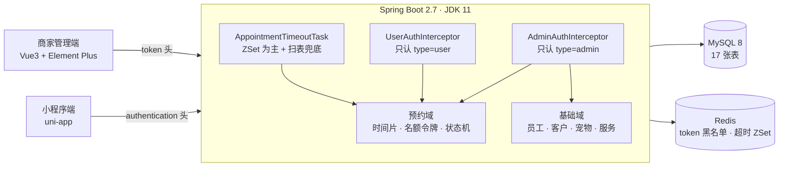

# pet-service-platform


[](https://github.com/XHH-software/pet-service-platform/actions/workflows/ci.yml)


宠物服务预约平台后端（Spring Boot + MyBatis-Plus + MySQL + Redis + JWT），同时供两个前端调用：

- 商家管理端：[pet-web-admin-kit](https://github.com/XHH-software/pet-web-admin-kit)（Vue 3 + Element Plus + Vite，默认 8081）
- 小程序端：[pet-wx-users-kit](https://github.com/XHH-software/pet-wx-users-kit)（uni-app，H5 调试常用 8082）

接口是按这两个前端已经写好的调用契约反推实现的，不是空壳也不是写死的 mock：列表、详情、下单、支付、核销、排班、CRUD、上传都能直接联调。

一开始只想把接口补齐，做下去发现麻烦的地方不在 CRUD，而在同一份资源被并发抢：一个技师同一个 30 分钟里只能接一只宠物，限量服务不能卖超，没付款的单不能一直挂着。

这几块占的时间最多。做法和踩过的坑记在第 7 章，几个当时只能这么定的选择放在第 8 章，没做完的部分在第 11 章。

> 想先了解全貌：[docs/项目梳理.md](docs/项目梳理.md) —— 数据模型、下单流程、状态机、接口清单、技术债。



---

## 0. 快速开始（Docker，推荐）

装好 Docker Desktop 后，三条命令起完整环境（MySQL + Redis + 应用，自动建表 + 播种演示数据）：

```bash
cp .env.example .env          # 按需改端口/密码；JWT_SECRET 记得换
docker compose up -d --build
docker compose logs -f app    # 看到 Started PetServicePlatformApplication 即就绪
```

访问 `http://localhost:8080`，用下面的演示账号直接登录。想清空数据重来：`docker compose down -v`。

> 不想用 Docker 的，看第 3 章的手动启动方式，逻辑完全一样。

---

## 1. 技术栈

| 组件 | 版本 / 说明 |
| --- | --- |
| JDK | 11 |
| Spring Boot | 2.7.18 |
| MyBatis-Plus | 3.5.5（分页插件） |
| MySQL | 8.x，库名 `pet_service_platform` |
| Redis | 3.x / 5.x，用于 token 黑名单、订单超时 ZSet |
| JWT | jjwt 0.11.5（HS256） |
| 密码 | Spring Security BCrypt |
| 文件存储 | 本地磁盘（默认）/ 阿里云 OSS（可切换） |
| 构建 | Maven |

---

## 2. 目录结构

```
pet-service-platform/
├─ Dockerfile                     # 多阶段构建：maven 打包 → JRE11 运行
├─ docker-compose.yml             # MySQL + Redis + 应用，一条命令起全套
├─ .env.example                   # 端口 / 密码 / JWT_SECRET 等环境变量模板
├─ sql/schema.sql                 # 17 张表 DDL（含名额令牌表），演示数据由启动器播种
├─ src/main/java/com/pet/platform/
│  ├─ common/                     # Result / PageResult / UserContext / @AutoFill + AOP
│  ├─ config/                     # WebConfig（拦截器、CORS、静态资源）、MyBatis-Plus、Jackson
│  ├─ security/                   # JwtUtil / AdminAuthInterceptor / UserAuthInterceptor / TokenService
│  ├─ storage/                    # 本地 / OSS 上传
│  ├─ task/AppointmentTimeoutTask # Redis ZSet 超时关单 + 扫表兜底
│  ├─ init/DemoDataInitializer    # 首次启动播种演示数据
│  └─ module/
│     ├─ auth, staff, customer, pet, address
│     ├─ service（服务项目 / 套餐 / 分类）
│     ├─ schedule, appointment, review
│     ├─ shop, dashboard, upload
├─ src/test/
│  ├─ java/com/pet/platform/      # 24 个集成测试（并发 / 限量 / 排班校验 / 降级 / 越权）
│  └─ resources/
│     ├─ application-test.yml     # H2 内存库 + 故意不可用的 Redis
│     └─ schema-h2.sql            # 与生产 DDL 同构的 H2 版本
├─ src/main/resources/application.yml
└─ pom.xml
```

---

## 3. 环境与启动

### 3.1 前置依赖

> 已有 Docker 的话可以直接跳到第 0 章，无需在本机装 MySQL / Redis。

1. MySQL 8 运行在 `localhost:3306`，账号 `root / root`
2. Redis 运行在 `localhost:6379`
3. JDK 11、Maven 3.6+

### 3.2 初始化数据库

```bash
mysql -uroot -proot --default-character-set=utf8mb4 < sql/schema.sql
```

> 该脚本会 `DROP TABLE` 后重建，仅用于开发/演示。重建后请执行 `redis-cli flushdb`，再重启后端。

### 3.3 启动后端

```bash
mvn -DskipTests package
java -jar target/pet-service-platform-1.0.0.jar
```

服务地址：`http://localhost:8080`。首次启动检测到 `staff` 表为空时，会自动播种：

- 1 家门店、4 个分类、8 个服务项目、3 个套餐
- 5 名员工、5 名客户、8 只宠物
- 本周排班、约 30 条历史/今日预约、10 条评价

### 3.4 启动前端联调

```bash
# 管理端
cd D:\pet-web-admin-kit
npm install
npm run dev            # http://localhost:8081

# 小程序 H5
cd D:\pet-wx-users-kit
npm install
npm run dev:h5 -- --port 8082   # http://localhost:8082（不加参数时默认 5173）
```

- 管理端 `VITE_API_BASE=/api`，Vite 代理到 `http://localhost:8080` 并去掉 `/api`。
- 小程序 `src/utils/request.js` 直连 `http://localhost:8080`，后端已开启 CORS。

---

## 4. 演示账号

### 管理端（`POST /admin/staff/login`）

| 账号 | 密码 | 姓名 | 职位 |
| --- | --- | --- | --- |
| `admin` | `123456` | 张伟 | 店长 |
| `13800000002` | `123456` | 王芳 | 美容师 |
| `13800000003` | `123456` | 李娜 | 美容师 |
| `13800000004` | `123456` | 孙悦 | 美容师 |
| `13800000005` | `123456` | 赵敏 | 助理 |

> 账号也支持用手机号登录。

### 小程序端

开发期微信登录为 mock：`POST /user/login` 传 `{"code":"dev_mock_code"}` 即固定绑定客户 **张女士（id=1，13812341234）**。H5 端在 `uni.login` 失败时会自动回退到该 code。

---

## 5. 鉴权与响应约定

### 5.1 请求头

| 端 | Header | 说明 |
| --- | --- | --- |
| 管理端 | `token: <jwt>` | 兼容 `Authorization: Bearer <jwt>` |
| 小程序 | `authentication: <jwt>` | 兼容 `token` |

### 5.2 统一响应

```json
{ "code": 1, "msg": null, "data": {} }
```

| code | 含义 | HTTP 状态 |
| --- | --- | --- |
| 1 | 成功 | 200 |
| 0 | 业务失败（参数、状态、冲突等） | 200 |
| 401 | 未登录 / token 过期 / 已登出 | 200 |

业务异常统一由 `GlobalExceptionHandler` 转为 `code=0`，前端只需判断 `code`。

### 5.3 双端隔离

- `/admin/**` 使用 `AdminAuthInterceptor`，只接受 `type=admin` 的 token，并校验 Redis 黑名单。
- `/user/**` 使用 `UserAuthInterceptor`，只接受 `type=user` 的 token。
- 两个拦截器都在 `afterCompletion` 中调用 `UserContext.clear()`，避免线程池复用导致用户串号。
- 放行路径：`/admin/staff/login`、`/user/login`、`/user/shop/status`、`/user/category/**`、`/user/service-item/**`、`/user/package/**`、`/user/schedule/available`。

---

## 6. 接口清单

### 6.1 管理端 `/admin/**`

| 模块 | 方法与路径 | 说明 |
| --- | --- | --- |
| 认证 | `POST /admin/staff/login` | 员工登录，返回 `{id,name,token}` |
| | `POST /admin/staff/logout` | 登出，token 写入 Redis 黑名单 |
| | `PUT /admin/staff/password` | 修改密码（旧密码校验，成功后需重新登录） |
| 工作台 | `GET /admin/dashboard/summary` | 今日预约/待服务/营业额/出勤 |
| | `GET /admin/dashboard/trend` | 近 7 日预约数与营业额 |
| | `GET /admin/report/staff-rank` | 技师排行 Top 5 |
| 预约 | `GET /admin/appointment/page` | 分页；支持 `startDate/endDate/appointmentDate/status/staffId/keyword`，`appointmentDate` 支持 `today`/`今天` |
| | `GET /admin/appointment/calendar?date=` | 日历视图 |
| | `GET /admin/appointment/{id}` | 详情（手机号不脱敏） |
| | `POST /admin/appointment` | 代客下单（`status=2`、`source=2`，不进入超时关单） |
| | `POST /admin/appointment/{id}/checkin` | 核销 |
| | `POST /admin/appointment/{id}/complete` | 完成服务 |
| | `POST /admin/appointment/{id}/cancel` | 取消 |
| 排班 | `GET /admin/schedule/week?startDate=` | 周视图 |
| | `PUT /admin/schedule/create` | 单日新增（body 用 `date`） |
| | `PUT /admin/schedule/{id}` | 修改单日排班 |
| | `DELETE /admin/schedule/{id}` | 删除 |
| | `POST /admin/schedule/batch` | 批量排班 |
| | `POST /admin/schedule/copy` | 复制上周（body `startDate`） |
| 服务项目 | `GET /admin/service-item/page` / `GET /admin/service-item/{id}` | 分页 / 详情 |
| | `POST` `PUT` `DELETE /admin/service-item` | 新增 / 修改 / 删除（删除用 `?id=`） |
| | `POST /admin/service-item/status/{status}?id=` | 上下架 |
| 套餐 | `GET /admin/package/page` / `GET /admin/package/{id}` | 分页 / 详情 |
| | `POST` `PUT` `DELETE /admin/package` | 新增 / 修改 / 删除 |
| | `POST /admin/package/status/{status}?id=` | 上下架 |
| 分类 | `GET /admin/category/page` / `GET /admin/category/list` | 分页 / 下拉 |
| | `POST` `PUT` `DELETE /admin/category` | 新增 / 修改 / 删除 |
| | `POST /admin/category/status/{status}?id=` | 启停 |
| 客户/宠物 | `GET /admin/customer/page` | 客户分页 |
| | `GET /admin/pet/page?customerId=` / `GET /admin/pet/{id}` | 宠物分页 / 详情（含预约记录） |
| 员工 | `GET /admin/staff/page` / `GET /admin/staff/list` / `GET /admin/staff/{id}` | 分页 / 下拉 / 详情 |
| | `POST` `PUT /admin/staff` | 新增 / 修改 |
| | `POST /admin/staff/status/{status}?id=` | 启用 / 停用 |
| 评价 | `GET /admin/review/page` | 分页（评分字段为 `rating`） |
| | `POST /admin/review/{id}/reply` | 商家回复 |
| 门店 | `GET /admin/shop` / `PUT /admin/shop` | 门店信息与营业时间 |
| 上传 | `POST /admin/common/upload` | `multipart/form-data` 字段名 `file`，仅 jpg/png，≤2MB，返回 URL |

### 6.2 小程序端 `/user/**`

| 模块 | 方法与路径 | 说明 |
| --- | --- | --- |
| 认证 | `POST /user/login` | 微信 code 登录（开发期 mock） |
| | `GET /user/info` / `PUT /user/info` | 当前客户信息 |
| 门店 | `GET /user/shop/status` | 门店状态、营业时间、地址电话 |
| 分类 | `GET /user/category/list?type=` | 分类数组 |
| 服务项目 | `GET /user/service-item/list` | **直接返回数组**，不分页 |
| | `GET /user/service-item/{id}` | 详情 |
| 套餐 | `GET /user/package/list` | **直接返回数组** |
| | `GET /user/package/{id}` | 详情，含 `price`（售价）与 `duration`（总时长） |
| 排班 | `GET /user/schedule/available?date=&serviceItemId=` | 可约员工与时段 |
| 预约 | `POST /user/appointment` | 下单（`status=1`、`source=1`，写入 Redis 超时 ZSet） |
| | `GET /user/appointment/page?status=` | 我的预约分页 |
| | `GET /user/appointment/{id}` | 详情（含 `serviceName`、`timeSlotName`、`hasReview`） |
| | `POST /user/appointment/{id}/pay` | 支付（演示环境直接置为已支付） |
| | `POST /user/appointment/{id}/cancel` | 取消 |
| 宠物 | `GET /user/pet/list` / `POST` `PUT` `DELETE /user/pet` | 宠物 CRUD |
| 地址 | `GET /user/address/list` / `POST` `PUT` `DELETE /user/address` | 地址 CRUD |
| 评价 | `GET /user/review/list` | 我的评价分页 |
| | `POST /user/review` | 发表评价（评分字段为 `score`） |

---

## 7. 核心实现说明

### 7.1 双端 JWT + 独立拦截器 + ThreadLocal

- `JwtUtil` 签发 HS256 token，payload 含 `sub=userId`、`type=admin|user`、`exp`。
- 管理端读 `token` 头，小程序读 `authentication` 头，分别校验 `type`，互不串用。
- 登录用户信息存入 `UserContext`（`ThreadLocal`），请求结束在 `afterCompletion` 清理。
- 登出把 token 写入 Redis 黑名单（`jwt:blacklist:*`，TTL 与 token 剩余有效期一致）；Redis 不可用时降级为仅依赖 JWT 过期时间，不阻断业务。

### 7.2 自定义注解 + AOP 公共字段填充

- `@AutoFill(INSERT|UPDATE)` 标注在 Service 写方法上。
- `AutoFillAspect` 环绕通知扫描方法参数中的 `BaseEntity`，统一填充 `createTime/updateTime/createBy/updateBy`，`createBy/updateBy` 取自 `UserContext`。
- `BaseEntity` 作为所有业务实体父类，避免每个 Service 手写重复赋值。

### 7.3 预约时段冲突 + `schedule.booked_count` 原子自增

- 下单时按 `staffId + date + 时间段` 查询 `appointment_slot`，存在重叠即拒绝，提示“该时段已被预约，请选择其他时间”。
- 真正的正确性来自 `appointment_slot` 上的唯一索引，前面的查询只负责给出友好提示。
- 排班表的已约数用**单条原子自增**更新：

  ```sql
  update schedule
     set booked_count = booked_count + 1, version = version + 1, update_time = now()
   where id = #{id}
  ```

  这里刻意不带 `version` 条件。早先的写法是“读 `version` → 带 `version` 更新 → 失败重试”，但在 MySQL 默认的 `REPEATABLE_READ` 下，同一事务内的一致性读共用首次快照，重试读到的仍是旧 `version`，5 次重试必然全败，`booked_count` 静默少记（8 单只记 1 单）。`booked_count = booked_count + 1` 本身由 InnoDB 行锁保证原子，不需要乐观锁。
- `booked_count` 只服务排班周视图展示；能不能约以 `appointment_slot` 为准，所以它出问题不会导致超卖。

### 7.4 Redis ZSet 订单超时关闭 + 扫表兜底

- 小程序下单后写入 `appointment:timeout`，score 为到期时间戳（默认 30 分钟，`app.order.timeout-minutes`）。
- `AppointmentTimeoutTask` 每 30 秒按 score 拉取到期订单并关闭；支付/取消后从 ZSet 移除。
- 每 5 分钟扫表兜底：查询 `status=1 且 create_time < now-30min` 的订单，避免 Redis 写入失败导致订单永久待支付。
- Redis 异常时只记录日志，不影响下单主流程。

### 7.5 订单号与状态

- 订单号格式：`AP + yyyyMMdd + 6 位自增主键`，例如 `AP20261028000137`。**由主键派生，插入后在同一事务里回填**（`order_no` 因此允许为空），唯一性由主键天然保证。
  早先的做法是“查当天最大号 + 1”，属于读-改-写：并发下多个事务读到同一个号，只能靠唯一索引冲突后重试，而重试时其他事务同样未提交，于是连续冲突——8 个并发下单会有 5 个被拒。现在不存在任何竞态，也不需要重试。
- 状态：`1 待支付`、`2 待服务`、`3 服务中`、`4 已取消`、`5 已完成`、`6 已评价`（与两端前端 `APPOINTMENT_STATUS` 完全一致）。
- 管理端代下单初始 `status=2`、`source=2`；小程序下单初始 `status=1`、`source=1`。

### 7.6 展示字段适配

前端存在同一业务字段不同命名的情况，后端在实体上用 `@TableField(exist = false)` 做别名兼容，不改数据库：

- 管理端门店用 `status`，小程序用 `businessStatus`
- 管理端评价用 `rating`，小程序用 `score`
- 小程序评价页需要 `serviceName`、`timeSlotName`
- 小程序套餐详情需要 `price`、`duration`

---

### 7.7 每日名额（`daily_limit`）

`service_item.daily_limit` / `service_package.daily_limit` 是「该服务每天最多接几单」。

最省事的做法是下单前 count 一下当天订单数，没超就往下走。问题在两个请求同时 count 到 9（上限 10）时，都会判断「还能接」，然后一起写进去 11 单——判断和写入之间那个时间窗，靠应用层关不掉。

所以这里把名额做成一行可以被抢的令牌：

```sql
CREATE TABLE service_daily_quota (
  quota_date DATE NOT NULL,
  service_item_id BIGINT,      -- 与 package_id 二选一
  package_id BIGINT,
  seq INT NOT NULL,            -- 当天第几个名额，1..daily_limit
  appointment_id BIGINT NOT NULL,
  UNIQUE KEY uk_item_date_seq (service_item_id, quota_date, seq),
  UNIQUE KEY uk_package_date_seq (package_id, quota_date, seq)
);
```

下单时按 `seq = 1..limit` 逐个尝试插入，插入成功即占到名额，`DuplicateKeyException` 说明该序号被抢了就顺延；全部序号都被占满 → 当日名额用完（`AppointmentService#reserveDailyQuota`）。

- **没有先查后写的时间窗**：判断和占位是同一条 INSERT。
- **不会与真实订单漂移**：订单回滚，令牌行跟着回滚；取消订单时按 `appointment_id` 整批删除（`releaseDailyQuota`）。
- **不用 Redis 计数器**：计数器丢 key 或事务回滚会永久性多卖/少卖，而数据库行和订单在同一个事务里。

`daily_limit = 0` 或 `NULL` 视为不限量，直接跳过令牌写入。

### 7.8 订单号：从「读最大号 + 1」改成「按主键派生」

这一节写得长一点，因为三版实现都留着，能看出问题是从哪冒出来的——它符合「看着能跑、并发下必崩」的样子。

**第一版：`synchronized` + 查当天最大号 + 1。** 单机内串行，看似安全。但锁只护住了「读号 + 插入」这一小段，事务提交在锁外——**前一个事务还没提交时，后一个线程查不到它刚插入的行**，于是生成同一个号，撞上 `order_no` 唯一索引。

**第二版：冲突后重取号重试 3 次。** 把 `DuplicateKeyException` 从「抛给用户」改成「换个号再试」。但重试时其他并发事务同样没提交，读到的最大号还是同一个，于是又撞。并发用例的结果：**8 个互不冲突的时段同时下单，5 个报「下单人数较多」**——不是时段冲突，全是订单号冲突。这个用例现在还留在 `AppointmentConcurrencyTest` 里。

**最终版：订单号由自增主键派生，插入后在同一事务里回填。**

```java
appointmentMapper.insert(appointment);                    // order_no 暂为 NULL
String orderNo = OrderNo.of(date, appointment.getId());   // AP + yyyyMMdd + 6 位 id
appointmentMapper.update(null, Wrappers.<Appointment>lambdaUpdate()
        .set(Appointment::getOrderNo, orderNo)
        .eq(Appointment::getId, appointment.getId()));
```

唯一性由主键天然保证，**不存在竞态，也就不需要重试**。代价有两条，都写进已知边界：`order_no` 列允许为空（只在同一事务的两条语句之间为空，提交前一定回填）；号段是全局自增、跨天连续，不再每天从 `0001` 开始。

---

## 8. 关键设计决策

当时做选择时的记录，代价写在第三列：

| 决策 | 为什么这么做 | 代价 / 边界 |
| --- | --- | --- |
| 时间按 30 分钟切片，单独建 `appointment_slot` 表 | 时间区间本身无法加唯一约束，切成离散块之后才能让数据库来兜底并发 | 服务时长必须是 30 的整数倍；跨片服务要占多行 |
| 冲突校验「查一次 + 唯一索引兜底」两层 | 查一次是为了给出友好提示，唯一索引才是正确性的保证 | 提示信息需要区分两种失败来源 |
| Redis 只做加速，不做事实来源 | 缓存一定会挂；订单是钱，不能因为缓存挂了就下不了单 | 缓存不可用时关单会延迟最多 5 分钟（扫表周期） |
| 管理端与小程序各一套 token 与拦截器 | 一个 token 走天下时，用户 token 能直接调管理端接口 | 多一个 `type` 字段的校验成本 |
| 名额用令牌表而不是计数器 | 令牌与订单同事务，天然不会漂移 | 多一张表，取消时要显式回收 |
| 订单号由自增主键派生，而不是读当天最大号 | 读-改-写在并发下必然取到重号，重试也救不回来 | `order_no` 允许为空（事务内短暂），号段跨天连续 |
| 已约数用 `booked_count = booked_count + 1` | 自增本身原子，不需要乐观锁；带 `version` 重试在 RR 下是空转 | 无法感知“这一行被谁改过”，但该字段只用于展示 |
| 集成测试用 H2 而不是 Testcontainers | clone 下来 `mvn test` 就能跑，不需要装 Docker | H2 与 MySQL 有方言差异，需要单独维护一份同构 DDL |

---

## 9. 测试与验证

```bash
mvn test        # 24 个用例，约 40 秒，不依赖 Docker / MySQL / Redis
```

测试直接跑真实 Spring 容器 + 真实 MyBatis-Plus + H2(MODE=MySQL)，**不 mock Mapper**——要验证的正是数据库约束本身。`application-test.yml` 里 Redis 被故意指向 `127.0.0.1:1`，所以每个用例都在「缓存不可用」的真实降级路径上运行。

| 测试类 | 用例 | 验证什么 |
| --- | --- | --- |
| `AppointmentConcurrencyTest` | `onlyOneBookingWinsForTheSameSlot` | 16 线程抢同一技师同一时段，**只有 1 单成功**，时间片只留 2 行，`booked_count` 只 +1 |
| | `adjacentSlotStaysAvailableAfterBooking` | 10:00 被占后 10:30 仍可下单，切片之间不误伤 |
| | `longServiceBlocksEverySlotItCovers` | 60 分钟服务会把 10:30 这个起点一起占掉 |
| | `cancelReleasesSlots` | 取消后时间片释放，同一时段可被重新预订 |
| | `bookedCountStaysAccurateForConcurrentDifferentSlots` | 8 个线程并发下**互不冲突的 8 个时段全部成交**，`booked_count` 恰好等于 8（钉住“已约数不能用读-改-写更新”） |
| `AppointmentDailyLimitTest` | `rejectsTheFourthBookingAndAcceptsAfterCancel` | 限额 3 的项目第 4 单被拒；取消一单后名额回收、可以再约 |
| | `concurrentBookingsNeverExceedDailyLimit` | 8 个并发抢 3 个名额，**恰好成交 3 单**，不多不少 |
| | `unlimitedServiceIsNotCapped` | `daily_limit=0` 不受限，且不写令牌行 |
| `RedisDowntimeTest` | `bookingStillWorksWhenRedisIsDown` | 先断言 Redis 确实连不上，再断言下单照样成功落库 |
| | `scanFallbackFindsUnpaidAppointmentsWithoutRedis` | ZSet 不可用时，扫表查询仍能找出超时待支付单 |
| `DualEndAuthTest` | `userTokenCannotCallAdminApi` | 小程序 token 调 `/admin/**` → 401 |
| | `adminTokenCannotCallUserApi` | 管理端 token 调 `/user/**` → 401 |
| | `missingTokenIsRejectedAndValidTokenPasses` | 无 token 拒绝、正确 token 放行 |
| | `bearerHeaderIsAlsoAccepted` | `Authorization: Bearer` 兼容 |
| | `tamperedTokenIsRejected` | 篡改签名 / 乱写 token 一律 401 |
| `ScheduleValidationTest` | `batchRejectsReversedRange` / `batchRejectsNullTime` | 批量排班原来不校验时间，能写进 `start >= end` 的排班；现在被拒绝且不落库 |
| | `batchRejectsTooShortRange` / `batchRejectsTooLongSpan` | 不足 30 分钟排不出任何可约时段；跨度上限 90 天，防止误传年份把库写爆 |
| | `deleteRejectedWhenDayHasBookings` / `deleteWorksWhenDayIsFree` | 当天已有预约时拒绝删排班（否则留下“预约还在、排班没了”的孤儿单）；空闲时可正常删 |
| | `updateRejectsShrinkingBelowBookedSlot` / `updateAllowsWideningRange` | 时间区间不能缩到已预约时段之外，放大则允许 |
| | `copySkipsInvalidSourceRows` | 复制上周排班时跳过历史脏数据，不因为一条坏记录阻断整周 |

---

## 10. 配置说明

`src/main/resources/application.yml`：

```yaml
server.port: 8080
spring.datasource.url: jdbc:mysql://localhost:3306/pet_service_platform...
spring.datasource.username/password: root/root
spring.redis.host/port: localhost/6379
app.jwt.secret: ...            # 生产环境务必替换
app.jwt.expire-days: 7
app.upload.type: local         # local | oss
app.upload.dir: ./uploads
app.upload.base-url: http://localhost:8080
app.wx.mock: true              # 开发期微信登录 mock
app.order.timeout-minutes: 30
app.cors.allowed-origins: '*'  # 逗号分隔的来源白名单，* 表示不限制
```

切换到 OSS：把 `app.upload.type` 改为 `oss`，并填写 `app.upload.oss.*` 的 endpoint/bucket/AK/SK。

所有配置都支持环境变量覆盖，容器化部署时只需注入环境变量（模板见 `.env.example`）：

| 环境变量 | 默认值 | 说明 |
| --- | --- | --- |
| `SERVER_PORT` | `8080` | 服务端口 |
| `DB_URL` | `jdbc:mysql://localhost:3306/pet_service_platform...` | 数据库连接 |
| `DB_USERNAME` / `DB_PASSWORD` | `root` / `root` | 数据库账号 |
| `REDIS_HOST` / `REDIS_PORT` | `localhost` / `6379` | Redis 地址 |
| `JWT_SECRET` | 仓库内的占位值 | **生产必须替换**，建议 `openssl rand -base64 32` |
| `UPLOAD_TYPE` / `UPLOAD_DIR` | `local` / `./uploads` | 存储方式与目录 |
| `WX_MOCK` | `true` | 关掉才会走真实微信登录 |
| `ORDER_TIMEOUT_MINUTES` | `30` | 未支付自动关单时长 |
| `CORS_ALLOWED_ORIGINS` | `*` | 允许的跨域来源，逗号分隔；生产建议填具体域名 |

---

## 11. 已知边界与没做的部分

1. **没有购物车、没有商品库存扣减**。这个项目是服务预约业务，不是电商；并发控制做的是「时段冲突校验 + 唯一索引兜底 + 名额令牌」，跟商品库存防超卖不是一回事。
2. **微信登录是开发期 mock**。`app.wx.mock=true` 时任意 code 都映射到 `mock_openid_dev`（张女士）。**部署到公网前必须配置 `app.wx.app-id/app-secret` 并把 `WX_MOCK` 设为 false，同时替换 `JWT_SECRET`**——否则任何人都能登进演示账号。
3. **支付是演示实现**。`/user/appointment/{id}/pay` 直接把订单置为已支付，未接微信支付。
4. **单门店**。`shop` 表只有一条记录，未做多租户/多门店隔离。
5. **小程序代下单页忽略 `packageId`**。前端 `appointment/create` 只处理 `serviceItemId`，套餐预约目前仅后端接口支持，属前端缺口。
6. **每日名额只对下单生效**。启动器播种的历史订单是直接 insert 的，不会写入名额令牌，因此演示数据里“今天的已约数”不占当日名额。
7. **疫苗过期拦截**。演示数据中 `雪球` 疫苗已过期，下单会被拒绝，这是预期业务校验。
8. **上传文件保存在本地 `./uploads`**，通过 `/uploads/**` 静态访问；生产建议切 OSS 或对象存储。
9. **订单号是“日期 + 自增主键”，号段跨天连续**，不再是每天从 0001 开始（换来的是零竞态，见 7.8）。已有库升级需执行 `ALTER TABLE appointment MODIFY order_no VARCHAR(20) NULL;`。
10. 管理端列表手机号脱敏（`138****1234`），详情接口返回完整号码。

---

## 12. 快速自测

```bash
# 管理端登录
curl -s -X POST http://localhost:8080/admin/staff/login \
  -H "Content-Type: application/json" \
  -d '{"username":"admin","password":"123456"}'

# 工作台今日预约
curl -s "http://localhost:8080/admin/appointment/page?appointmentDate=today&page=1&pageSize=10" \
  -H "token: <上一步返回的 token>"

# 小程序 mock 登录
curl -s -X POST http://localhost:8080/user/login \
  -H "Content-Type: application/json" \
  -d '{"code":"dev_mock_code"}'

# 未登录应返回 code=401
curl -s http://localhost:8080/user/pet/list
```
