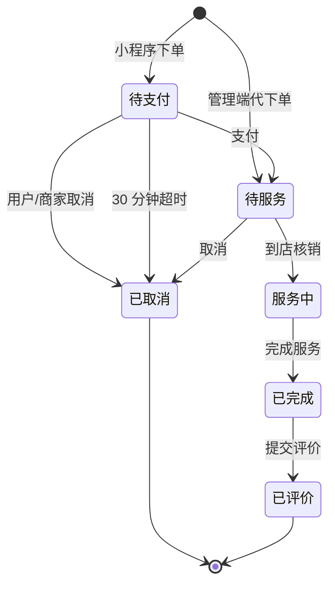

# pet-service-platform 项目梳理

> 用途：后续迭代时的索引 / 设计决策备查
> 基线：`main` 分支，96 个主代码文件、6 个测试文件、17 张表、23 个控制器 76 个接口、24 个用例全绿

---

## 一、这个项目是什么

宠物洗护门店的**预约履约后端**。同一套接口同时供两个前端调用：

| 前端 | 技术栈 | 鉴权头 | 仓库 |
|---|---|---|---|
| 商家管理端 | Vue 3 + Element Plus | `token` | `pet-web-admin-kit` |
| 小程序 / H5 | uni-app | `authentication` | `pet-wx-users-kit` |

业务主线只有一条：**客户选门店 → 选服务 → 选技师的可约时段 → 下单 → 支付 → 到店核销 → 完成 → 评价**。
所有技术复杂度都服务于这条主线上的三个真问题：时段不能撞、名额不能超、订单不能永远挂着不关。

不是电商，没有购物车和商品库存；核心是「**时间资源**」和「**服务产能**」的占用与释放。

---

## 二、技术栈

| 层 | 选型 | 说明 |
|---|---|---|
| 运行时 | JDK 11 / Spring Boot 2.7.18 | 单模块 Maven 工程 |
| Web | spring-boot-starter-web | 拦截器鉴权，无 Spring Security 全家桶 |
| 持久层 | MyBatis-Plus 3.5.x | 单表 CRUD 走 Wrapper，复杂统计走自定义 SQL |
| 数据库 | MySQL 8 | 17 张表，约束承担并发正确性 |
| 缓存 | Redis | 只做两件事：token 黑名单、超时订单 ZSet |
| 鉴权 | jjwt 0.11.5（HS256）+ spring-security-crypto | 密码 BCrypt 加盐 |
| 其他 | Lombok、AOP（`@AutoFill` 自动填充审计字段）、阿里云 OSS SDK（可选） | |
| 测试 | JUnit 5 + Spring Boot Test + H2 | 不依赖 Docker / MySQL / Redis |

**刻意的取舍**：不上 Spring Security、不上多模块、不上 MQ。理由是单门店单体应用，引入这些只会增加阅读成本；真正需要严谨的地方（并发、幂等、鉴权）用约束和少量代码解决。

---

## 三、代码结构

```
src/main/java/com/pet/platform/
├── PetServicePlatformApplication.java   @SpringBootApplication + @EnableScheduling + @MapperScan
├── common/          Result / PageResult / UserContext / BusinessException / 全局异常处理
│                    @AutoFill + AutoFillAspect（create_by / update_by / 时间戳）
├── config/          WebConfig（拦截器注册、CORS、静态资源）、MyBatisPlusConfig、JacksonConfig
├── security/        JwtUtil / JwtProperties / TokenService / AdminAuthInterceptor / UserAuthInterceptor
├── storage/         本地磁盘与 OSS 两种实现，按 app.upload.type 切换
├── task/            AppointmentTimeoutTask（ZSet 为主 + 扫表兜底）
├── init/            DemoDataInitializer（staff 表为空时播种演示数据，日期基于 today）
└── module/          71 个文件，按域分包，每域 controller / service / mapper / entity
    ├── appointment  12  预约（核心域，AppointmentService 916 行）
    ├── service      12  服务项目 / 套餐 / 套餐明细
    ├── customer     13  客户 / 宠物 / 收货地址
    ├── shop          7  门店 / 营业时间
    ├── staff         6  员工 / 擅长项目
    ├── schedule      5  排班（含已约数原子自增）
    ├── category      5  服务分类
    ├── review        5  评价
    ├── auth          3  双端登录 / 登出
    ├── dashboard     2  看板与排行
    └── upload        1  文件上传
```

**分层约定**：`Controller` 只做参数绑定与 `Result` 包装，业务判断全在 `Service`，`Mapper` 继承 `BaseMapper` 或写注解 SQL。
请求体与实体复用（`Appointment`、`Customer` 直接当 DTO），换来的是少一层转换；代价是入参校验靠手写 if，见第十二节。

---

## 四、数据模型（17 张表）

### 4.1 四组表

| 组 | 表 | 说明 |
|---|---|---|
| 门店与人员 | `staff`、`staff_specialty`、`shop`、`shop_business_hour` | 技师是排班与预约的归属主体；门店只有一条记录 |
| 商品与服务 | `category`、`service_item`、`service_package`、`package_detail` | 服务项目有时长、价格、`pet_size_limit`、`daily_limit`；套餐由明细组合，总时长 = 明细时长之和 |
| 客户与宠物 | `customer`、`pet`、`customer_address` | 宠物有 `species`、`weight`、`vaccine_expiry_date`，疫苗过期**直接拦截下单** |
| 交易与占用 | `schedule`、`appointment`、`appointment_item`、`appointment_slot`、`service_daily_quota`、`review` | 见下 |

### 4.2 四张关键表的关系

```
schedule（技师某天 9:00-18:00，booked_count + version）
   │  1 : N
appointment（一单：客户 × 宠物 × 技师 × 起止时间 × 状态 × 金额）
   ├─ 1 : N  appointment_item      明细（服务项目或套餐，价格快照）
   ├─ 1 : N  appointment_slot      占用的 30 分钟时间片 ← 唯一索引在这
   └─ 1 : N  service_daily_quota   占用的当日名额令牌 ← 唯一索引在这
```

### 4.3 三个决定正确性的约束

```sql
-- ① 同一技师、同一天、同一个 30 分钟只能被一单占用
UNIQUE KEY uk_staff_date_slot (staff_id, appointment_date, slot_time)

-- ② 名额就是"某天第 N 个坑位"，N 上有唯一约束
UNIQUE KEY uk_item_date_seq   (service_item_id, quota_date, seq)
UNIQUE KEY uk_package_date_seq (package_id,     quota_date, seq)

-- ③ 订单号不能重复；由自增主键派生，插入后回填，故允许为空（见第七节）
order_no VARCHAR(20) NULL UNIQUE
```

> 这三条约束是项目里最值钱的部分。**业务代码负责给出人能看懂的报错，数据库负责保证结果正确**。

---

## 五、核心链路

### 5.1 下单 `AppointmentService.create()`（288-463 行）

18 个步骤，可以按四段记：

**① 入参与归属（289-310）**
`petId` / `staffId` 非空 → 宠物存在 → 宠物属于当前客户（管理端代下单可由 `customerId` 覆盖） → 疫苗有效期非空且未过期。

**② 商品与价格（319-378）**
套餐分支校验上架状态、取套餐总时长与售价；单点分支校验每个服务项上架、宠物体型适配（`validatePetSize`），累加时长与金额。
同时收集 `QuotaTarget`（要占哪个服务/套餐的多少个名额），**为后面的名额占用做准备**。

**③ 排班与时段（380-414）**
技师存在且启用 → 当日排班存在且启用 → 结束时间计算（管理端允许手填并向上取整到半小时，小程序按服务总时长算） → 不超出排班范围 → 当天不能约已过去的时段 → `selectCount` 预检时间片冲突。

**④ 落库与占位（416-457）**
写主表（先插入拿 id，再按 id 回填订单号）→ 写明细 → 占名额令牌 → 逐 30 分钟写时间片（唯一索引兜底）→ `booked_count` 原子 +1 → 非管理端下单挂 Redis 超时（**失败只 warn，不影响下单**）。

事务边界：整个 `create` 一个事务。名额令牌、时间片、明细任何一步失败都整体回滚，不会出现"占了位却没订单"。

### 5.2 其余动作

| 动作 | 前置状态 | 后置状态 | 附带操作 |
|---|---|---|---|
| `pay` | 1 待支付 | 2 待服务 | `pay_status=1`、记录 `pay_time`、**移出 ZSet** |
| `checkin` | 2 待服务 | 3 服务中 | 无（管理端扫码/输入单号） |
| `complete` | 3 服务中 | 5 已完成 | 未付则视为已付（到店付款场景） |
| `cancel` | 1 / 2 | 4 已取消 | 释放时间片 + **回收名额令牌** + `booked_count-1` + 移出 ZSet |
| `expireUnpaid` | 1 且超 30 分钟 | 4 已取消 | 同上，`cancel_reason` 记为系统取消 |
| `review` | 5 已完成 | 6 已评价 | 一单一评 |

`cancel` 与 `expireUnpaid` 复用 `releaseSlots()`，三种资源（时间片 / 名额 / 计数）一次释放干净——**这是最容易漏的地方**，漏一个就会出现"位子空着但约不上"。

### 5.3 超时关单

```
下单 → ZADD appointment:timeout  <到期时间戳> <orderId>
        ↓ 每 30 秒
   ZRANGEBYSCORE 取到期 id（每次 100 条）→ expireUnpaid → ZREM
        ↓ 每 5 分钟
   扫表兜底：status=1 且 create_time < now-30min
```

ZSet 走的是"正常路径"，扫表是"ZSet 写失败或 Redis 丢数据"的保险。两条路径都调同一个 `expireUnpaid`，天然幂等（状态不是 1 就直接 return）。

---

## 六、订单状态机



`status`：1 待支付 / 2 待服务 / 3 服务中 / 4 已取消 / 5 已完成 / 6 已评价
`pay_status`：0 未付 / 1 已付 / 2 已退（取消已付订单时置 2，无真实退款）

---

## 七、并发与一致性

| # | 问题 | 手段 | 代码位置 | 失效时的表现 |
|---|---|---|---|---|
| 1 | 两人抢同一时段 | 先 `selectCount` 给友好提示，再由 `uk_staff_date_slot` 兜底，捕获 `DuplicateKeyException` 转业务异常 | `create` 407-452 | 只有一单成功，另一单收到"该时段刚刚被预约" |
| 2 | 每日限量超卖 | 令牌表按 `seq=1..limit` 逐个 INSERT，插入成功即占位，全占满则失败 | `reserveDailyQuota` 636 | 判断与占位是同一句 SQL，无 TOCTOU 窗口 |
| 3 | `booked_count` 丢更新 | 单条 `booked_count = booked_count + 1` 原子自增 | `changeBooked` | 自增由行锁保证，不需要 version；该字段只用于排班周视图展示 |
| 4 | 订单号并发重复 | 订单号由自增主键派生，插入后回填，零竞态 | `create()` 写库段 | 号段跨天连续；`order_no` 事务内短暂为空 |

**为什么不用 Redis 计数器做限量**：计数器丢 key 或事务回滚后没减回去，就会永久多卖/少卖；令牌行和订单在同一事务里，订单回滚令牌自动回滚。

**为什么保留 `selectCount` 预检**：唯一索引只能告诉你"插不进去"，说不出"哪个时段满了"。预检负责体验，索引负责正确，两者不冲突。

---

## 八、鉴权链路

```
登录 → JWT(HS256)，payload: sub=userId, type=admin|user
   ├─ /admin/**  → AdminAuthInterceptor：校验签名 + type 必须为 admin + 未进黑名单
   └─ /user/**   → UserAuthInterceptor ：校验签名 + type 必须为 user  + 未进黑名单
                        ↓
                 UserContext（ThreadLocal）
                        ↓ afterCompletion 必须 clear()
```

- **双端隔离是重点**：只验签不验 type，用户 token 就能调管理端接口。两个拦截器各自只认自己那一端的 type，越权一律 401。
- `UserContext.clear()` 放在 `afterCompletion`：Tomcat 线程复用，不清会把上一个请求的身份带给下一个。
- 登出把 token 写进 Redis 黑名单（TTL = 剩余有效期）；**Redis 不可用时退化为"等 token 自然过期"，不阻断登出**。
- 密码 BCrypt 加盐；管理端列表手机号脱敏 `138****1234`，详情接口才返回完整号码。

---

## 九、接口地图（23 个控制器 / 76 个接口）

路径前缀就两种：`/admin/**`（管理端）、`/user/**`（客户端），这是双端隔离的物理边界。

| 域 | 控制器 | 路径 | 数量 |
|---|---|---|---|
| 预约 | AppointmentController | `/admin/appointment` | 7 |
| 预约 | UserAppointmentController | `/user/appointment` | 5 |
| 排班 | ScheduleController | `/admin/schedule` | 6 |
| 排班 | UserScheduleController | `/user/schedule` | 1 |
| 服务 | ServiceItemController / PackageController | `/admin/service-item`、`/admin/package` | 6 + 6 |
| 服务 | UserServiceItemController / UserPackageController | `/user/service-item`、`/user/package` | 2 + 2 |
| 分类 | CategoryController / UserCategoryController | `/admin/category`、`/user/category` | 6 + 1 |
| 客户 | CustomerController / PetController | `/admin/customer`、`/admin/pet` | 1 + 2 |
| 客户 | UserPetController / AddressController | `/user/pet`、`/user/address` | 4 + 4 |
| 员工 | StaffController | `/admin/staff` | 6 |
| 登录 | AdminAuthController | `/admin/staff`（login/logout/me） | 3 |
| 登录 | UserAuthController | `/user`（login/info/update） | 3 |
| 评价 | ReviewController / UserReviewController | `/admin/review`、`/user/review` | 2 + 2 |
| 门店 | ShopController / UserShopController | `/admin/shop`、`/user/shop` | 2 + 1 |
| 看板 | DashboardController | `/admin/dashboard/*`、`/admin/report/staff-rank` | 3 |
| 上传 | UploadController | `/admin/common/upload` | 1 |

统一响应：`Result<T>{ code, msg, data }`（code=1 成功 / 0 业务失败 / 401 未登录），分页用 `PageResult<T>{ total, records }`。

---

## 十、测试资产（`mvn test`，24 个用例，约 40 秒）

| 类 | 数量 | 验证什么 | 耗时 |
|---|---|---|---|
| `AppointmentConcurrencyTest` | 5 | 16 线程抢同一时段只有 1 单成交、时间片只留赢家、`booked_count` 只 +1、跨片冲突、取消后释放、8 线程并发订 8 个不同时段全部成交且计数恰好为 8 | 15.0s |
| `AppointmentDailyLimitTest` | 3 | 限额 3 时第 4 单被拒、取消后可再约、8 并发抢 3 名额恰好成交 3 单 | 0.55s |
| `DualEndAuthTest` | 5 | 用户 token 调 `/admin/**`、管理员 token 调 `/user/**` 均 401 | 4.8s |
| `RedisDowntimeTest` | 2 | 先断言 Redis 确实连不上，再断言下单照常落库 | 0.1s |
| `ScheduleValidationTest` | 9 | 批量排班不校验时间（`start >= end`、空值、不足 30 分钟、跨度超限）、删排班留下孤儿时间片、改排班把已约时段切到区间外、复制上周跳过脏数据 | 0.3s |
| `BaseIntegrationTest` | — | 公共基类：真实 Spring 容器 + 真实 Mapper + H2 | — |

三个关键设计：

1. **不 mock Mapper**。要验证的正是唯一索引这类数据库约束，mock 掉等于把被测对象删了。
2. **H2 用 MySQL 模式**，并给 JDBC URL 加 `LOCK_TIMEOUT=15000`——H2 默认 1 秒等锁超时会抛 `50200` 并在回滚时报 `Connection is closed`，看着像事务 bug，其实是等锁超时。
3. **`application-test.yml` 把 Redis 指向 `127.0.0.1:1`**，让每个用例都跑在"缓存不可用"的真实降级路径上，而不是用 mock 假装故障。

---

## 十一、工程化

| 文件 | 作用 |
|---|---|
| `Dockerfile` | 多阶段构建（maven → jre），依赖层单独缓存，改代码不重拉包 |
| `docker-compose.yml` | MySQL 8 + Redis 7 + 应用，healthcheck 保证启动顺序，`schema.sql` 挂 initdb 自动建表 |
| `.env.example` | 端口 / 密码 / JWT_SECRET / 微信 appid 模板 |
| `.github/workflows/ci.yml` | JDK 11 + `mvn test`，**不依赖外部服务所以真能变绿** |
| `sql/schema.sql` | 17 张表 DDL（建表顺序已处理外键依赖；无物理外键，靠索引） |
| `init/DemoDataInitializer` | 首次启动播种演示数据，日期基于 `LocalDate.now()`，clone 下来就有数据 |

---

## 十二、技术债与边界（按处理优先级）

**本轮已修（2026-11）**

- `booked_count` 乐观锁重试在 RR 下空转 → 改为单条原子自增，补「8 线程订 8 个不同时段、计数恰好 8」用例。
- 订单号「查最大号 + 1」在并发下必然重号，重试 3 次仍失败（8 并发挂 5 个）→ 改为由自增主键派生、插入后回填。
- 批量排班不校验时间（可写入 `start >= end`）、删除排班不检查已有预约（留下孤儿时间片）、改排班可把已约时段切到区间外 → 全部加校验，`ScheduleValidationTest` 9 个用例覆盖。
- CORS 从硬编码 `*` 改为 `app.cors.allowed-origins`（默认 `*`，生产用 `CORS_ALLOWED_ORIGINS` 收紧）。

**该修的**

1. `app.wx.mock=true` 是默认值，任意 code 都能登成 1 号客户；叠加 `application.yml` 里的默认 JWT secret，**本地/演示环境等于没有鉴权**。README 顶部需要显眼警告，生产必须用环境变量覆盖。
2. 请求体与实体复用，`@Valid` 基本没用起来，参数校验散落在 Service 的 if 里。要扩展就该抽出 DTO + 分组校验。
3. 无物理外键，删除服务项目/技师时靠代码判断引用关系，容易漏。至少给关键删除加引用检查。
4. 报表类接口直接查库聚合，数据量上来会慢；`dashboard/trend` 适合加按天预聚合。

**已知且可接受**

5. 支付是演示实现（`/user/appointment/{id}/pay` 直接置为已付），未接微信支付。
6. 单门店，`shop` 表只有一条记录，无多租户隔离。
7. 小程序代下单页忽略 `packageId`，套餐预约目前只有后端接口支持，属前端缺口。
8. 上传默认落本地 `./uploads`，生产建议切 OSS（`app.upload.type=oss` 已支持）。
9. 订单号 = 日期 + 自增主键，号段跨天连续，不再是每天从 0001 开始。
